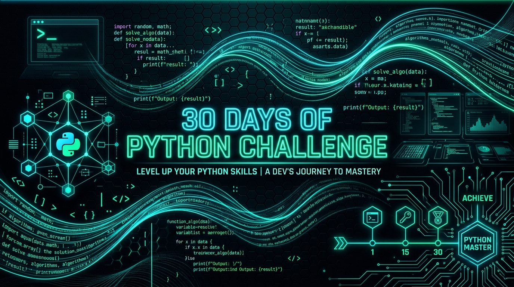
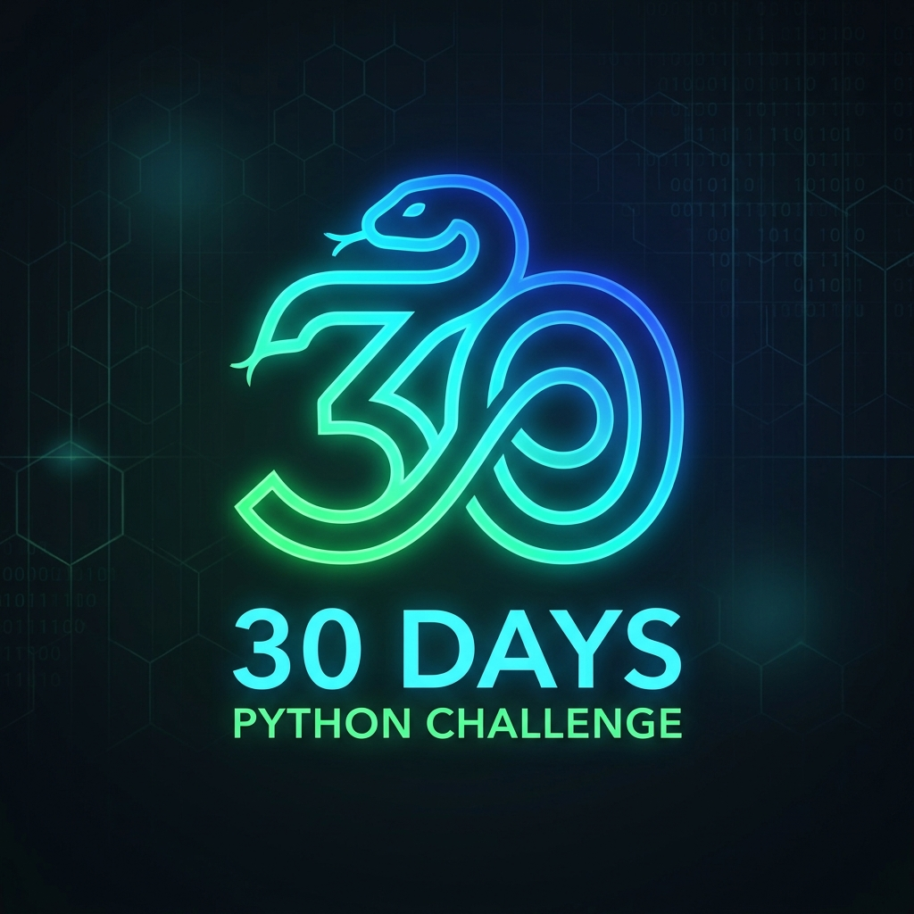

<div align="center">

  

  <a href="https://github.com/Tejas0113/30_days_Python_Challenge">
    
  </a>

  # 🐍 30 Days of Python Challenge
  ### *Level Up Your Python Skills — Generative Art, Visual Simulations, Games & Creative Computing*

  <p align="center">
    <strong>An intensive, hands-on 30-day journey building 30 real-world Python applications: mathematical generative art, animated GUI widgets, physics simulations, 2D arcade games, visual algorithms, and graphics engines.</strong>
  </p>

  <p align="center">
    <!-- PROGRESS_BADGE_START -->
  
<!-- PROGRESS_BADGE_END -->
  </p>

  <p align="center">
    
    
    
    
    <a href="https://github.com/Tejas0113/30_days_Python_Challenge/stargazers">
      
    </a>
    <a href="https://github.com/Tejas0113/30_days_Python_Challenge/network/members">
      
    </a>
  </p>

  <p align="center">
    <a href="#-about-the-challenge">📖 About</a> •
    <a href="#-challenge-progress-tracker">📊 Live Tracker</a> •
    <a href="#-30-day-roadmap--curriculum">🗺️ 30-Day Roadmap</a> •
    <a href="#-automated-sync--ci">⚙️ Auto-Sync CI</a> •
    <a href="#-quick-start">🚀 Quick Start</a> •
    <a href="#-repository-structure">📁 Project Structure</a> •
    <a href="#-connect--author">👨‍💻 Author</a>
  </p>

  ---

</div>

<br/>

## 🎯 About The Challenge

Welcome to the **30 Days of Python Challenge**! This repository documents an immersive, daily coding expedition aimed at mastering modern Python through hands-on, creative, and visually engaging projects.

Every single day is structured around building a complete, runnable application — moving through **mathematical generative art**, **dynamic GUI animations**, **interactive physics sandboxes**, **classic 2D arcade games**, **algorithmic visualizers**, and **custom graphics engines**.

### 🌟 Core Principles
- ⚡ **Daily Consistency**: 1 Day = 1 Complete Standalone Project.
- 🎨 **Visual & Engaging**: Every project is interactive, visual, or directly playable.
- 🧱 **Clean Architecture**: Modular structure, type hints, clear documentation, and graceful lifecycle handling.
- 🤖 **Zero Manual Overhead**: Automatic progress calculations and README synchronization on every Git push.
- 📂 **Encapsulated Documentation**: Detailed project breakdowns, previews, and run guides live inside each day's dedicated folder.

---

## 📊 Challenge Progress Tracker

<!-- PROGRESS_BAR_START -->
```text
[███░░░░░░░░░░░░░░░░░░░░░░░░░] 10.0% (3/30 Days Completed)
```
<!-- PROGRESS_BAR_END -->

<div align="center">

| 🏆 Milestone | Goal | Status |
| :--- | :--- | :---: |
| **Stage 1: Creative Foundations & 2D Arcade** | Days 01 – 10 (Generative Art, Physics & Retro Games) | `IN PROGRESS 🚀` |
| **Stage 2: Visual Simulations & Fractals** | Days 11 – 20 (Cellular Automata, Chaos, Raycasting & Particles) | `PENDING ⏳` |
| **Stage 3: Advanced Computing & 3D Engines** | Days 21 – 30 (Pathfinding, Swarm AI, 3D Wireframe & CV Art) | `PENDING ⏳` |

</div>

---

## 🗺️ 30-Day Roadmap & Curriculum

<!-- CHALLENGE_TABLE_START -->
| Day | Project Title | Key Concepts | Category | Status | Code |
| :---: | :--- | :--- | :--- | :---: | :---: |
| **Day 01** | [Infinite Rainbow Spiral](days/Day-01-Infinite-Spiral) | `Turtle Graphics, HSV Color Space, Frame Buffering` | Generative Art | `✅ Completed` | [Source](days/Day-01-Infinite-Spiral/main.py) |
| **Day 02** | [Turtle Flower Drawing](days/Day-02-Flower-Drawing) | `Turtle Graphics, Parametric Curves, Spiral Phyllotaxis` | Generative Art | `✅ Completed` | [Source](days/Day-02-Flower-Drawing/main.py) |
| **Day 03** | [Animated Analog Clock](days/Day-03-Automated-Clock) | `Tkinter Canvas, Datetime, Trigonometric Hand Angles` | GUI & Automation | `✅ Completed` | [Source](days/Day-03-Automated-Clock/main.py) |
| **Day 04** | **Neon Arcade Pong Game** | `Turtle / Pygame, Elastic Collisions, Keyboard Input Binding` | 2D Game Dev | `⏳ Up Next` | *(Building)* |
| **Day 05** | Procedural Fractal Tree & Forest | `Recursive Algorithms, Branching Angles, Dynamic Color Gradients` | Generative Art | `🔒 Planned` | — |
| **Day 06** | Retro Snake Arcade | `Grid Coordinates, List Queues, Game Loops, Collision Detection` | 2D Game Dev | `🔒 Planned` | — |
| **Day 07** | Conway's Game of Life Simulation | `Cellular Automata, 2D Array Grids, State Evolution Rules` | Simulation | `🔒 Planned` | — |
| **Day 08** | Interactive Kaleidoscope & Mandala | `Rotational Symmetry, Polar-to-Cartesian Mapping, Event Listeners` | Generative Art | `🔒 Planned` | — |
| **Day 09** | Flappy Bird Physics Clone | `Gravity & Velocity Vectors, Obstacle Spawning, AABB Hitboxes` | 2D Game Dev | `🔒 Planned` | — |
| **Day 10** | Gravitational Solar System Simulator | `Newtonian Gravity, Orbital Mechanics, Vector Acceleration` | Physics Simulation | `🔒 Planned` | — |
| **Day 11** | Matrix Digital Rain Visualizer | `Terminal Buffering, Glyph Streams, Decay Timing` | Visual Effects | `🔒 Planned` | — |
| **Day 12** | Sorting Algorithm Visualizer | `Sorting Algorithms, Visual Bar Swaps, Algorithmic Complexity` | Algorithm Visualizer | `🔒 Planned` | — |
| **Day 13** | Double Pendulum Chaos Simulator | `Chaos Theory, Lagrangian Mechanics, Numerical Integration` | Physics Simulation | `🔒 Planned` | — |
| **Day 14** | Retro Space Invaders Arcade | `Sprite Arrays, Projectile Management, Marching Movement Logic` | 2D Game Dev | `🔒 Planned` | — |
| **Day 15** | Algorithmic Maze Generator & Solver | `Depth-First Search (DFS), Recursive Backtracking, Graph Traversal` | Algorithm Visualizer | `🔒 Planned` | — |
| **Day 16** | Particle Fireworks & Sparkle Engine | `Particle Systems, Velocity Decay, Radial Burst Physics` | Particle Systems | `🔒 Planned` | — |
| **Day 17** | Mandelbrot & Julia Set Fractal Explorer | `Complex Numbers, Escape-Time Formula, Color Paletting` | Mathematical Art | `🔒 Planned` | — |
| **Day 18** | Audio Spectrum & Beat Visualizer | `Fast Fourier Transform (FFT), Frequency Bins, Dynamic Scaling` | Audio & Signal Processing | `🔒 Planned` | — |
| **Day 19** | Elastic Balls Collision Physics Sandbox | `2D Vector Math, Elastic Collision Response, Momentum Conservation` | Physics Simulation | `🔒 Planned` | — |
| **Day 20** | 2D Raycasting Pseudo-3D Engine | `Raycasting, DDA Algorithm, Field of View (FOV), Wall Slicing` | Graphics Engine | `🔒 Planned` | — |
| **Day 21** | A* & Dijkstra Pathfinding Visualizer | `A* Search, Dijkstra Algorithm, Priority Queues, Manhattan Distance` | Algorithm Visualizer | `🔒 Planned` | — |
| **Day 22** | Interactive Water Ripple Wave Sandbox | `Discrete Wave Equation, Velocity Damping, Surface Disturbance` | Physics Simulation | `🔒 Planned` | — |
| **Day 23** | Classic Asteroids Vector Space Combat | `Angular Momentum, Toroidal Screen Wrap, Polygonal Splitting` | 2D Game Dev | `🔒 Planned` | — |
| **Day 24** | Cyberpunk Digital Synth & Piano | `Audio Synthesis, Sine Waves, GUI Keypress Binding` | GUI & Audio | `🔒 Planned` | — |
| **Day 25** | 3D Perspective Infinite Starfield Flight | `3D-to-2D Perspective Projection, Z-axis Warp, Velocity Trails` | Visual Effects | `🔒 Planned` | — |
| **Day 26** | Craig Reynolds Boids Flocking Simulation | `Flocking Algorithms, Autonomous Agents, Vector Steering` | Autonomous Systems | `🔒 Planned` | — |
| **Day 27** | Live ASCII Art Video Streamer | `OpenCV, Grayscale Luminance Mapping, Terminal Canvas Rendering` | Computer Vision Art | `🔒 Planned` | — |
| **Day 28** | Hand Gesture Air Canvas Painter | `MediaPipe / OpenCV, Hand Landmarks, Gesture Recognition` | Computer Vision & AI | `🔒 Planned` | — |
| **Day 29** | 3D Wireframe Graphics Engine from Scratch | `3D Transformation Matrices, Euler Rotations, Perspective Camera` | 3D Graphics Engine | `🔒 Planned` | — |
| **Day 30** | Grand Finale: Neon Cyber Arcade Hub | `Multi-Game Architecture, Particle FX, State Managers, Audio Integration` | Game & Visual Suite | `🔒 Planned` | — |
<!-- CHALLENGE_TABLE_END -->

---

## ⚙️ Automated Sync & CI

This repository is equipped with an automated tracking engine designed to keep the README, progress bar, badges, and challenge table synchronized automatically with every commit.

```
📁 Git Commit / Change
       │
       ▼
🪝 Automated Pre-Commit Hook (.git/hooks/pre-commit)
       │
       ▼
🐍 Tracker Script (scripts/update_tracker.py)
       │
       ├── 🔍 Scans `days/` directory for completed projects
       ├── 📈 Computes completion percentage & stats
       ├── 🎨 Updates high-tech progress bar & badges
       └── 📝 Commits updated README.md automatically
```

### 🛠️ Developer CLI Shortcuts

#### 1. Bootstrap a New Challenge Day in One Command:
```bash
# Auto-loads title, description, and concepts from the curriculum:
python scripts/new_day.py 4

# Or specify custom details:
python scripts/new_day.py 4 "Neon Arcade Pong Game" "Classic 2-player arcade" "Turtle, Pygame, Physics"
```
*Creates the day's folder, starter code template, day README, and updates the master tracker table instantly.*

#### 2. Install Automatic Pre-Commit Hook:
```bash
python scripts/setup_git_hook.py
```
*Ensures every `git commit` automatically updates README progress without manual intervention.*

#### 3. Manually Re-sync Tracker:
```bash
python scripts/update_tracker.py
```

---

## 🚀 Quick Start

### 1. Clone the Repository
```bash
git clone https://github.com/Tejas0113/30_days_Python_Challenge.git
cd 30_days_Python_Challenge
```

### 2. Set Up Virtual Environment
```bash
# Create virtual environment
python3 -m venv .venv

# Activate on macOS / Linux:
source .venv/bin/activate

# Activate on Windows:
# .venv\Scripts\activate
```

### 3. Install Dependencies
```bash
pip install -r requirements.txt
```

### 4. Run Any Challenge Day
```bash
# Example: Run Day 01
python days/Day-01-Infinite-Spiral/main.py

# Example: Run Day 02
python days/Day-02-Flower-Drawing/main.py

# Example: Run Day 03
python days/Day-03-Automated-Clock/main.py
```

---

## 📁 Repository Structure

```tree
30_days_Python_Challenge/
├── assets/                        # Banners, logos, and preview graphics
├── days/                          # All 30 challenge projects (each with code + README)
│   ├── Day-01-Infinite-Spiral/    # Day 01: Infinite Rainbow Spiral
│   │   ├── main.py                # Standalone project source
│   │   └── README.md              # Project documentation, math & previews
│   ├── Day-02-Flower-Drawing/     # Day 02: Turtle Flower Drawing
│   │   ├── main.py
│   │   └── README.md
│   ├── Day-03-Automated-Clock/    # Day 03: Animated Analog Clock
│   │   ├── main.py
│   │   └── README.md
│   └── ...                        # Days 04 through 30
├── scripts/                       # Automation, CI & scaffolding tooling
│   ├── new_day.py                 # CLI: Scaffolds a new day & syncs table
│   ├── setup_git_hook.py          # Auto-hook: Syncs README on git commit
│   ├── update_tracker.py          # Auto-calculates stats & updates README
│   └── github_workflow_update_readme.yml
├── .gitignore                     # Ignores virtual environments & build artifacts
├── LICENSE                        # MIT License
├── README.md                      # Master aesthetic challenge dashboard
└── requirements.txt               # Optional helper dependencies
```

---

## 🤝 Contributing

Contributions, feedback, and suggestions are warmly welcome!
1. **Fork** the repository.
2. Create your feature branch (`git checkout -b feature/amazing-feature`).
3. Commit your changes (`git commit -m "feat: add amazing feature"`).
4. Push to the branch (`git push origin feature/amazing-feature`).
5. Open a **Pull Request**.

---

## 👨‍💻 Connect & Author

<div align="center">

**Crafted with ❤️ and Python by [Tejas (@Tejas0113)](https://github.com/Tejas0113)**

[](https://github.com/Tejas0113)

⭐ **If you find this repository inspiring or helpful, please consider giving it a star!** ⭐

</div>

---

<div align="center">
  <sub>Released under the <a href="LICENSE">MIT License</a>. Copyright &copy; 2026 Tejas0113.</sub>
</div>
