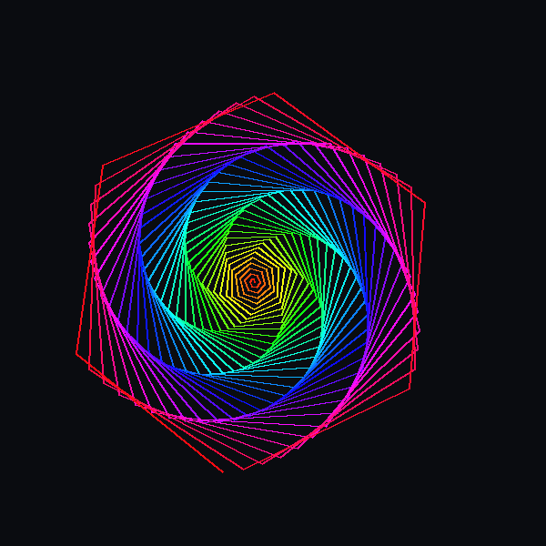

# 🌀 Day 01: Infinite Rainbow Spiral

> **30 Days of Python Challenge** · Level Up Your Python Skills  
> Created by **[@Tejas0113](https://github.com/Tejas0113)**

---

<p align="center">
  
</p>

<p align="center">
  
  
  
</p>

---

## 📖 Overview

Day 1 kicks off the challenge with a mesmerizing generative art project: an **Infinite Rotating Rainbow Spiral**. 

Instead of static geometric shapes, this project implements a dynamic animation loop featuring **continuous hue cycling**, **sub-degree angular rotation**, and **manual frame rendering (tracer/update buffering)** for an ultra-smooth 60 FPS animation loop.

---

## 🧠 Concepts & Mathematical Mechanics

### 1. The HSV Color Wheel
Python's standard `colorsys` library is used to generate smooth rainbow chromatic gradients:
- **Hue ($H \in [0, 1]$)**: Calculated as `i / n` where `i` represents the current line segment and `n` is 220. This traces a complete circle around the HSV color wheel.
- **Saturation ($S = 0.95$) & Value ($V = 1.0$)**: Maintained near peak saturation and maximum brightness to produce electric neon colors against a pitch-black canvas.
- Converted seamlessly to RGB via `colorsys.hsv_to_rgb(hue, 0.95, 1.0)`.

### 2. Angular Divergence ($59^\circ$)
A 6-sided polygon has internal turning angles of $60^\circ$ ($360^\circ / 6$). By turning **$59^\circ$** instead:
$$\Delta\theta = 60^\circ - 59^\circ = 1^\circ$$
Each arm shifts by $1^\circ$ per cycle, creating a spiraling vortex illusion reminiscent of sacred geometry and galaxy arms.

### 3. High-FPS Frame Buffering
Standard turtle graphics draws line-by-line, causing visible flicker and lag:
```python
screen.tracer(0)      # Disable automatic redraws
# ... draw entire spiral in memory buffer ...
screen.update()       # Blit the entire frame instantly to the display
```
This double-buffering technique allows hundreds of lines to render instantaneously without tearing.

---

## 🚀 How to Run

From the repository root:

```bash
python days/Day-01-Infinite-Spiral/main.py
```

> **Tip:** Close the window or press `Ctrl + C` in the terminal to exit gracefully.

---

## 🛠️ Tech Stack & Modules

| Module | Built-in? | Purpose |
| :--- | :---: | :--- |
| `turtle` | ✅ Yes | Vector graphics rendering engine and GUI window |
| `colorsys` | ✅ Yes | Color space conversions (HSV to RGB) |

No external dependencies required! Runs right out of the box with standard Python 3.

---

## 💡 Key Learnings & Takeaways

- [x] Mastering Python `turtle` coordinates and screen orientation.
- [x] Understanding the difference between RGB and HSV color spaces.
- [x] Using `tracer(0)` and `update()` for tear-free 60 FPS procedural animations.
- [x] Handling clean program termination with `try...except (turtle.Terminator, KeyboardInterrupt)`.

---

<p align="center">
  <a href="../../README.md"><b>⬅️ Return to 30 Days Challenge Tracker</b></a>
</p>
