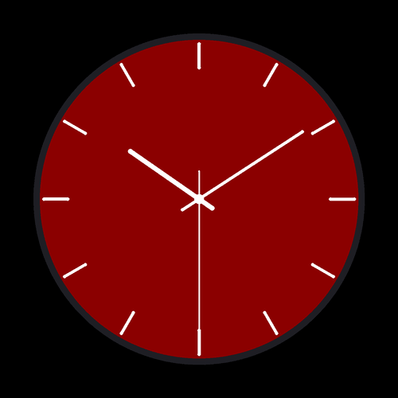

# ⏰ Day 03: Animated Analog Clock

> **30 Days of Python Challenge** · Level Up Your Python Skills  
> Created by **[@Tejas0113](https://github.com/Tejas0113)**

---

<p align="center">
  
</p>

<p align="center">
  
  
  
</p>

---

## 📖 Overview

Day 3 features a minimalist, high-contrast **Animated Crimson Clock** built using Python's built-in `tkinter`, `math`, and `datetime` libraries.

The clock renders a solid deep crimson face (`#8b0000`) nestled inside a dark charcoal outer rim (`#1e1e24`), highlighted by 12 glowing white hour tick markers. The hour, minute, and second hands are rendered with smooth continuous angular motion driven by microsecond resolution system time.

---

## 🧠 Concepts & Mathematical Mechanics

### 1. Sub-Second Continuous Angular Calculations
Instead of discrete 1-second ticking jumps, time is measured with microsecond precision ($s = \text{second} + \frac{\text{microsecond}}{10^6}$), creating silky smooth hand rotation:

- **Second Hand**: Complete $360^\circ$ revolution every 60 seconds ($6^\circ/\text{s}$):
  $$\theta_{\text{sec}} = (s \times 6^\circ) - 90^\circ$$

- **Minute Hand**: Continuous advance accounting for elapsed seconds:
  $$\theta_{\text{min}} = \left(\left(m + \frac{s}{60}\right) \times 6^\circ\right) - 90^\circ$$

- **Hour Hand**: Continuous advance factoring both minutes and fractional seconds:
  $$\theta_{\text{hour}} = \left(\left(h_{12} + \frac{m}{60} + \frac{s}{3600}\right) \times 30^\circ\right) - 90^\circ$$

*(Note: subtracting $90^\circ$ shifts standard Cartesian $0^\circ$ from East to the North $12:00$ position).*

### 2. Counter-Weight Tail Geometry
Each clock hand extends backwards beyond the center hub by a specified tail offset (`tail`), mimicking real mechanical luxury watches:
$$x_1 = c_x - \text{tail} \times \cos(\theta), \quad y_1 = c_y - \text{tail} \times \sin(\theta)$$
$$x_2 = c_x + \text{length} \times \cos(\theta), \quad y_2 = c_y + \text{length} \times \sin(\theta)$$

### 3. Canvas Layer Tagging & Refresh Loop
Instead of redrawing the entire static face on every tick, only items with the tag `"hands"` are deleted (`canvas.delete("hands")`) and redrawn before scheduling the next frame at 50ms intervals (`root.after(50, self.update_clock)`).

---

## 🚀 How to Run

From the repository root:

```bash
python days/Day-03-Automated-Clock/main.py
```

---

<p align="center">
  <a href="../../README.md"><b>⬅️ Return to 30 Days Challenge Tracker</b></a>
</p>
