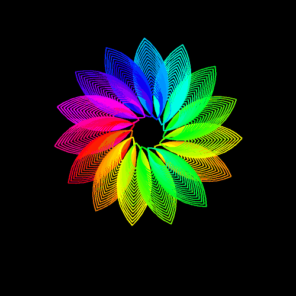

# 🌸 Day 04: Rotating Spiral Flower Design

> **30 Days of Python Challenge** · Level Up Your Python Skills  
> Created by **[@Tejas0113](https://github.com/Tejas0113)**

---

<p align="center">
  
</p>

<p align="center">
  
  
  
</p>

---

## 📖 Overview

Day 4 explores geometric generative art and dynamic motion through a hypnotic **Rotating Spiral Flower Design** rendered with Python's built-in `turtle` and `colorsys` libraries.

The project constructs an intricate floral vortex comprised of 16 radial petal clusters, each featuring 18 nested concentric arcs bathed in continuous HSV rainbow gradients. Once rendered, the entire geometry rotates smoothly around its coordinate origin using non-blocking timer callbacks and screen double-buffering.

---

## 🧠 Concepts & Mathematical Mechanics

### 1. Nested Dual-Arc Petal Geometry
Each petal segment is created using two complementary $90^\circ$ circular arcs:
- The turtle turns right $90^\circ$, traces a $90^\circ$ circular arc of radius $R = 150 - 6j$, turns left $90^\circ$, traces an identical return arc, and rotates $180^\circ$.
- As the inner loop variable $j$ increases from $0$ to $17$, the radius scales down from $150$ to $48$, creating concentric, layered petal contours.

### 2. Radial Symmetry & Overlapping Spiral Displacement
- The outer loop runs across $16$ petal clusters.
- At the conclusion of each petal cluster, `circle(40, 24)` displaces the turtle along a central hub arc of radius $40$ by $24^\circ$.
- Because $16 \times 24^\circ = 384^\circ$ ($24^\circ$ beyond a full $360^\circ$ circle), each layer rotates slightly past the previous one, generating an organic, spinning vortex illusion.

### 3. Continuous HSV Rainbow Gradient
Using Python's built-in `colorsys` module:
- Hue ($h \in [0.0, 1.0]$) increments by $0.005$ across each of the $288$ arcs ($16 \times 18$).
- `colorsys.hsv_to_rgb(h, 1, 1)` dynamically maps hue values into full-saturation, peak-brightness RGB neon color coordinates against the deep black canvas.

### 4. Double-Buffered Timer Rotation Loop
To animate the drawing smoothly without flicker:
```python
tracer(0, 0)         # Disable automatic redraws

def rotate():
    global current_angle
    clear()
    current_angle -= 1
    draw_flower(current_angle)
    update()         # Blit the frame instantaneously to the display
    ontimer(rotate, 20)  # Schedule next frame in 20ms (~50 FPS)
```
Using `ontimer` provides a responsive, non-blocking animation loop that keeps the GUI responsive while maintaining a steady 50 FPS framerate.

---

## 🚀 How to Run

From the repository root:

```bash
python days/Day-04-Design-of-Spiral-Flower/main.py
```

> **Tip:** Close the window or press `Ctrl + C` in the terminal to exit gracefully.

---

<p align="center">
  <a href="../../README.md"><b>⬅️ Return to 30 Days Challenge Tracker</b></a>
</p>
