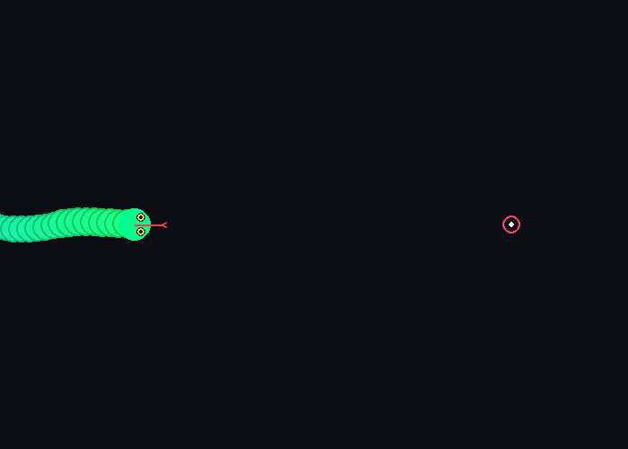

# 🐍 Day 05: Interactive Predatory Snake Movement

> **30 Days of Python Challenge** · Level Up Your Python Skills  
> Created by **[@Tejas0113](https://github.com/Tejas0113)**

---

<p align="center">
  
</p>

<p align="center">
  
  
  
</p>

---

## 📖 Overview

Day 5 introduces **Interactive Predatory Snake Movement**, a bio-inspired physics simulation built with Python.

Instead of a rigid grid or static skeleton, this project models an organic, fluid serpent that tracks your mouse cursor in real time. The snake exhibits distinct predatory behavior: when the cursor is far away, it slowly stalks and attracts towards it; as the cursor nears, the snake enters an aggressive **Strike Burst Mode**, accelerating rapidly to snap towards the target before smoothly coiling around it.

Equipped with a dual-engine architecture, it delivers smooth 60 FPS graphics via **Pygame** with an automatic zero-dependency **Tkinter Canvas** fallback so it runs out-of-the-box on any system.

---

## 🧠 Concepts & Mathematical Mechanics

### 1. Predatory Proximity Velocity Curve
Rather than moving at a constant rate, velocity dynamically scales based on Euclidean distance $d = \sqrt{\Delta x^2 + \Delta y^2}$ to the cursor:

- **Stalking Mode ($d > 350\text{px}$)**: Gentle cruising velocity ($v \approx 3.6\text{ px/frame}$) with slight breathing undulation:
  $$v_{\text{cruise}} = 3.6 + 0.6 \sin(0.5\phi)$$

- **Strike Acceleration ($15\text{px} < d \le 350\text{px}$)**: The closer the mouse cursor is, the faster the snake lunges forward:
  $$p = \frac{350 - d}{335}, \quad v_{\text{strike}} = 3.6 + 12.4 \times p^{1.5}$$
  *(Surges up to $16.0\text{ px/frame}$ for a predatory strike).*

- **Coiling Deceleration ($d \le 15\text{px}$)**: Smooth linear damping preventing jitter or oscillation around the cursor:
  $$v_{\text{coil}} = 3.0 \times \left(\frac{d}{15}\right)$$

### 2. Multi-Segment Inverse Kinematics (IK)
The spine consists of $N = 48$ segments of fixed length $L = 9\text{px}$. The head moves toward the target with momentum damping, and each successive vertebrae pulls the trailing segment:
$$\theta_i = \text{atan2}(y_{i-1} - y_i, \, x_{i-1} - x_i)$$
$$x_i = x_{i-1} - L \cos(\theta_i), \quad y_i = y_{i-1} - L \sin(\theta_i)$$

### 3. Transverse Traveling Slither Wave
Natural reptilian locomotion is produced by propagating a sine wave along the spine normal vector ($\mathbf{n}_i = \theta_i + \frac{\pi}{2}$):
$$w_i = 8.0 \times \sin\left(\frac{i}{N}\pi\right) \times \sin(\phi - 0.35i)$$
The wave phase advances proportionally to the snake's actual ground velocity ($\Delta\phi = v \times 0.075$), naturally pausing when stationary and rippling rapidly during strikes.

### 4. Anatomical Tapering & Rendering
- **Tapered Scales**: Body radius follows an organic power-curve:
  $$R(i) = \max\left(3, \, 18 \times \sqrt{1.0 - \left(\frac{i}{N}\right)^{1.3}}\right)$$
- **Viper Head**: Sculpted wedge head with golden reptile irises, vertical slit pupils directed towards the target, and a darting forked tongue.
- **Dorsal Spine Ridge**: Highlight dots along the backbone accentuate spinal bending.

---

## 🎮 Interactive Controls

| Control | Action |
| :--- | :--- |
| **Mouse Hover** | Guide the snake's attraction target |
| **Left Click** | Trigger an explosive burst lunge |
| **`C` Key** | Cycle themes *(Emerald Viper, Crimson Coral, Cyberpunk Neon, Arctic Frost)* |
| **`SPACE`** | Pause / resume simulation |
| **`ESC`** | Graceful exit |

---

## 🚀 How to Run

From the repository root:

```bash
python days/Day-05-Snake-Movement/main.py
```

*Note: Runs natively via Pygame. If Pygame is not installed, it automatically launches the built-in Tkinter Canvas mode.*

---

<p align="center">
  <a href="../../README.md"><b>⬅️ Return to 30 Days Challenge Tracker</b></a>
</p>
