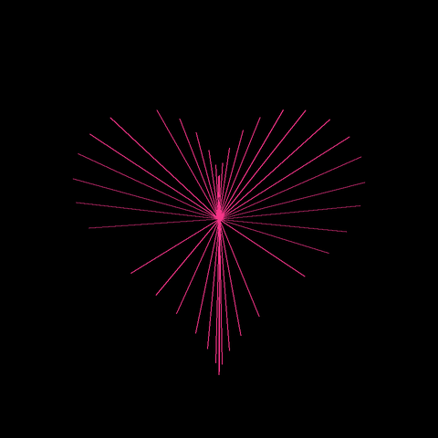

# 💖 Day 07: Love Art (Parametric Mathematical Heart)

> **30 Days of Python Challenge** · Level Up Your Python Skills  
> Created by **[@Tejas0113](https://github.com/Tejas0113)**

---

<p align="center">
  
</p>

<p align="center">
  
  
  
</p>

---

## 📖 Overview

Day 7 bridges pure mathematics and generative visual art with **Love Art**, an algorithmic renderer that brings a classic cardioid heart curve to life using Python's standard `turtle` and `math` libraries.

By calculating harmonic trigonometric coordinates and shooting 6,000 radial lines outward from the origin, the program produces an electric neon-pink glowing heart featuring radiant string-art textures and a razor-sharp geometric silhouette.

---

## 🧠 Concepts & Mathematical Mechanics

### 1. Parametric Cardioid Heart Equations
The perimeter geometry is governed by a modified Fourier-trigonometric parametric system:

$$\begin{aligned}
x(k) &= 15 \cdot \sin^3(k) \\
y(k) &= 12 \cdot \cos(k) - 5 \cdot \cos(2k) - 2 \cdot \cos(3k) - \cos(4k)
\end{aligned}$$

- **Horizontal Curvature $x(k)$**: The cubic sine power $\sin^3(k)$ flattens the curve near $k = 0$ and broadens the bilateral lobes symmetrically before tapering sharply at the cusp.
- **Vertical Silhouette $y(k)$**: The multi-harmonic cosine series superimposes 4 frequencies, sculpturing the top indentation (cleft), high shoulder ridges, and bottom acute vertex.

### 2. Integer-Step Angular Sampling & Ergodicity
Instead of tracing points sequentially with an infinitesimally small increment $\Delta k \to 0$, the algorithm steps $k$ by $1\text{ radian}$ for $i = 0, 1, 2, \dots, 5999$:
- Because $1\text{ rad}$ is incommensurable with $2\pi$ (i.e., $\frac{1}{2\pi}$ is irrational), the sampled angles never repeat exact coordinates.
- Successive rays bounce across the perimeter pseudo-ergodically, weaving a complex string-art web rather than drawing a simple continuous contour.

### 3. Radial Ray-Tracing & Filament Density
In each iteration of the loop:
1. The pen extends from the origin $(0, 0)$ out to $(x_i \cdot 20, y_i \cdot 20)$.
2. The pen immediately returns to $(0, 0)$.

As 6,000 rays accumulate, the spatial density is highest at the center $(0, 0)$ and gradually disperses towards the perimeter. This natural density gradient creates the illusion of an inner luminous neon core that radiates outward.

### 4. Isotropic Coordinate Space Normalization
Using `setworldcoordinates(-450, -450, 450, 450)`, the viewport is normalized to a symmetric $[-450, 450]$ grid. This guarantees:
- The origin $(0, 0)$ remains anchored precisely at the canvas center.
- The graphic scales uniformly without non-uniform stretching or aspect-ratio distortion regardless of screen resolution.

### 5. Accelerated Screen Refresh (`tracer(200)`)
`t.tracer(200)` tells Turtle to defer drawing flushes until every 200 ray computations, speeding up execution by orders of magnitude while preserving an enjoyable, progressive visualization.

---

## 🚀 How to Run

From the repository root:

```bash
python days/Day-07-Love-Art/main.py
```

> **Tip:** Close the window or press `Ctrl + C` in the terminal to exit gracefully.

---

<p align="center">
  <a href="../../README.md"><b>⬅️ Return to 30 Days Challenge Tracker</b></a>
</p>
