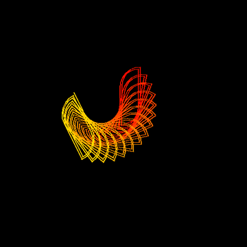

# 🌀 Day 11: Chromatic Circle Spiral Art

> **30 Days of Python Challenge** · Level Up Your Python Skills  
> Created by **[@Tejas0113](https://github.com/Tejas0113)**

---

<p align="center">
  
</p>

<p align="center">
  
  
  
</p>

---

## 📖 Overview

Day 11 explores harmonious geometric progression and continuous chromatic transitions with **Chromatic Circle Spiral Art**.

Built in 100% pure standard Python using `turtle` and `colorsys`, the program generates an intricate, multi-layered rotating spiral. Each iteration combines circular arc curvature with outward linear expansion and rotational precession, tracing an iridescent vortex against a deep pitch-black canvas.

---

## 🧠 Concepts & Mathematical Mechanics

### 1. HSV Chromatic Gradient Progression
The color palette evolves dynamically using the **Hue, Saturation, Value (HSV)** color space:

$$\text{Hue}(k) = (k \times \Delta h) \pmod{1.0}, \quad \text{where } \Delta h = 0.0025$$

This ensures a seamless, cyclical chromatic spectrum traversing reds, golds, greens, cyans, and magentas without hard color breaks.

### 2. Multi-Segment Arc Expansion
For each concentric layer $i \in [0, 399]$ and sub-segment $j \in [0, 3]$:
- **Curvature Radius**: $R(i, j) = 30 + 0.3i + 4j$ traversing an arc of $90^\circ$.
- **Radial Arm Extension**: $L(i) = 80 + 0.1i$.
- **Precession Angle**: An angular shift of $\Delta\theta = -11^\circ$ per layer rotates the entire rosette, producing an overlapping logarithmic-like phyllotaxis effect.

### 3. Screen Buffer Optimization (`tracer(0, 0)`)
`turtle.tracer(0, 0)` bypasses instantaneous screen redraws, updating only once every 5 layers to provide smooth, high-FPS generative rendering.

---

## 🚀 How to Run

From the repository root:

```bash
python "days/Day-11-Circle spiral/main.py"
```

---

<p align="center">
  <a href="../../README.md"><b>⬅️ Return to 30 Days Challenge Tracker</b></a>
</p>

