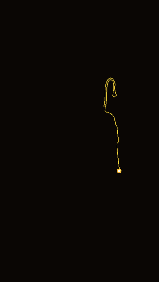

# 🚩 Day 12: Lord Shree Ram & Hanuman Ji - Divine Art Animation

> **30 Days of Python Challenge** · Level Up Your Python Skills  
> Created by **[@Tejas0113](https://github.com/Tejas0113)**

---

<p align="center">
  
</p>

<p align="center">
  
  
  
</p>

---

## 📖 Overview

Day 12 brings an aesthetic, cinematic devotional creative-coding experience: **Lord Shree Ram & Hanuman Ji Divine Art Animation**.

Inspired by the creative art of [@Gracyclub](https://github.com/Gracyclub/Shree-Ram-Hanuman-Divine-art), this project combines **OpenCV** computer vision with **Pygame** hardware-accelerated rendering. It unfolds in two synchronized visual phases:
1. **Live Contour Sketching**: Real-time tracing of the sacred contours of Lord Shree Ram and Lord Hanuman Ji using a glowing golden pen tip across a deep midnight canvas.
2. **Divine Illumination & Silhouette Reveal**: A seamless bloom into a radiant golden sunburst backdrop, edge-to-edge rotating god-rays, an infinitely scrolling horizontal *Jai Shri Ram* mantra stream, high-contrast solid black deity silhouettes, and a pulsing core solar flare.

---

## 🧠 Concepts & Mathematical Mechanics

### 1. Edge Detection & Polyline Contour Extraction
The input image is smoothed using a **bilateral filter** to preserve sharp boundary edges while removing high-frequency sensor noise:

$$\text{BF}[I](p) = \frac{1}{W_p} \sum_{q \in S} G_{\sigma_s}(\|p - q\|) G_{\sigma_r}(|I(p) - I(q)|) I(q)$$

Continuous edge contours are detected via the **Canny edge detector** (dual-threshold hysteresis $\tau_1 = 35, \tau_2 = 120$) and vectorized using `cv2.findContours(RETR_LIST)`. Only paths with length $L > 25\text{ px}$ are retained and sorted by arc length for progressive, cinematic line drawing.

### 2. Connected Components & Silhouette Segmentation
To separate the central divine figures from extraneous artifacts:
- Binary inverted thresholding isolates dark foreground figures.
- Connected component analysis (`cv2.connectedComponentsWithStats`) filters out small noise clusters ($\text{area} < 400\text{ px}^2$) and enforces vertical bounds ($y > 0.25 \times H$).
- Hole-filling contour fills (`cv2.drawContours(thickness=FILLED)`) ensure solid, unified deity silhouettes.

### 3. Radiant Sunburst Ray Geometry
The golden sunburst originates from the focal center $(X_c, Y_c) \approx (0.51W, 0.49H)$ between the deities:
- 32 angular sectors are defined by $\Delta\theta = \frac{2\pi}{N_{\text{beams}}}$.
- Every alternate triangular beam is projected to a radial distance $R_{\max} = 2 \times \sqrt{W^2 + H^2}$ using polar-to-Cartesian projection:

  $$P_k = \begin{pmatrix} X_c + R_{\max} \cos(k \Delta\theta) \\ Y_c + R_{\max} \sin(k \Delta\theta) \end{pmatrix}$$

### 4. Continuous Flowing Typography Stream
The sacred mantra `"  JAI SHRI RAM  "` is tiled horizontally across all screen rows. By continuously incrementing an offset modulo unit width:

$$x_{\text{offset}} = (x_{\text{offset}} + \Delta v) \pmod{w_{\text{unit}}}$$

all text rows move in uniform, smooth unidirectional harmony behind the solid deity silhouette.

### 5. Multi-Layer Alpha Blending & Pulsing Solar Flare
Using Pygame alpha-capable surfaces (`SRCALPHA`):
- Multi-tier radial gradients generate atmospheric god-ray dispersion.
- Harmonic sinusoidal oscillation modulates the central solar flare:

  $$r(t) = r_0 \left(1.0 + 0.08 \sin(0.006 t)\right)$$

producing an organic, breathing halo of divine energy.

---

## 🛠️ Tech Stack & Dependencies

- **Language**: Python 3.10+
- **Core Libraries**:
  - `pygame` / `pygame-ce` — Real-time windowing, multi-surface blending, and display flip.
  - `opencv-python` / `opencv-python-headless` — Edge detection, bilateral filtering, contour extraction, and connected component analysis.
  - `numpy` — Fast array masking and coordinate transformations.

---

## 🚀 How to Run

1. **Install dependencies** (if not already installed):
   ```bash
   pip install -r requirements.txt
   ```

2. **Execute the animation**:
   ```bash
   python days/Day-12-Shree-Ram-Hanuman-Divine-Art/main.py
   ```

> **Controls**:
> - Press **ESC** or **Q** to exit gracefully.
> - Close the window to terminate.

---

## 🌟 Credits & Acknowledgments
- Inspired by and adapted from the divine coding project by [Gracyclub/Shree-Ram-Hanuman-Divine-art](https://github.com/Gracyclub/Shree-Ram-Hanuman-Divine-art).

---

<p align="center">
  <a href="../../README.md"><b>⬅️ Return to 30 Days Challenge Tracker</b></a>
</p>

