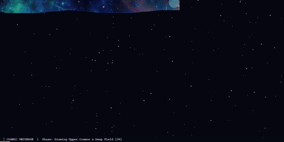

# 🌌 Day 13: Cosmic Universe - Fine Pencil Hatching Simulation & Stellar Ignition

> **30 Days of Python Challenge** · Level Up Your Python Skills  
> Created by **[@Tejas0113](https://github.com/Tejas0113)**

---

<p align="center">
  
</p>

<p align="center">
  
  
  
</p>

---

## 📖 Overview

Day 13 brings an authentic, satisfying colored-pencil drawing simulation: **Cosmic Universe - Fine Pencil Hatching Simulation & Stellar Ignition**.

The application models an artist's colored pencil drawing the entire celestial masterpiece steadily from corner to corner:
1. **Corner-to-Corner Diagonal Hatching**: Drawing begins precisely at the top-left corner `(0, 0)` in deep interstellar space, sweeping in continuous back-and-forth diagonal hatching bands ($x + y = d$) across 641 diagonals to reach the opposite corner `(1280, 640)`.
2. **Authentic Pencil Size**: Employs a fine pencil nib ($\sim 3\text{--}4\text{ px}$ width) mimicking traditional colored-pencil shading time-lapses.
3. **Ergonomic Colored Pencil Stylus**: A visible vector pencil leads the drawing frontier at a natural $50^\circ$ angle:
   - Dynamic lead tip reflecting the exact cosmic pigment at the active coordinate.
   - Sharpened cedar wood collar and 3D-shaded hexagonal barrel with golden ferrule.
   - Graphite and stardust micro-particles emitting from the contact point.
4. **Zero Noise, 100% Exact High-Fidelity Reproduction**: Every single stroke renders the exact master artwork—emerald nebula pillars, radiant azure core, magenta clouds, and golden cosmic cliffs along the horizon. Zero blur, zero digital static.
5. **Stellar Birth & Diffraction Flare Ignition**: As the drawing nears completion ($\ge 80\%$), prominent star cores ignite with astronomical 4-point cross diffraction spikes (JWST Carina Nebula style).
6. **Living Cosmos Interactive Mode**: Once complete, the universe remains alive with gentle stellar twinkling and real-time interactive stardust that responds to cursor movement.

---

## 🧠 Concepts & Mathematical Mechanics

### 1. Diagonal Zig-Zag Hatching Manifold ($x + y = d$)
To simulate continuous human hand hatching, the canvas is parameterized by diagonal level sets:

$$d = x + y, \quad d \in [0, W + H]$$

For each diagonal band $d$ spaced by pencil width $\Delta d = 3\text{ px}$:
- Bounding coordinate range: $x_{\min} = \max(0, d - H)$, $x_{\max} = \min(W, d)$
- Trajectory orientation alternates per band $i$:
  $$\mathbf{x}(s) = \begin{cases} (1 - s) x_{\min} + s\, x_{\max}, & i \text{ is even} \\ (1 - s) x_{\max} + s\, x_{\min}, & i \text{ is odd} \end{cases}$$
- This guarantees a continuous, unbroken zig-zag path spanning 154,250 points from $(0, 0)$ to $(W, H)$ with 100% pixel coverage and zero gaps.

### 2. Micro-Patch High-Fidelity Sampling
At each pencil tip coordinate $(x, y)$, a localized nib patch is transferred from the high-resolution master surface:

$$\Omega_{\text{pencil}}(x, y) = [x - R, x + R] \times [y - R, y + R], \quad R = 2\text{ px}$$

Because $\Delta s \le R$, consecutive pencil stamps overlap smoothly, producing solid, vibrant colored pencil strokes without digital artifacts or noise.

### 3. Astronomical 4-Point Diffraction Spike Optics
Prominent stars exhibit diffraction spikes caused by the spider vanes of astronomical telescopes. These are modeled mathematically using linear intensity decays with core Gaussian bloom:

$$I_{\text{spike}}(d) = I_0 \cdot \max\left(0, 1 - \frac{|d|}{L}\right)$$

Rendered with central luminous white discs, golden outer halos ($R \approx 20\text{ px}$), and orthogonal spikes spanning $L \approx 140\text{ px}$.

### 4. Harmonic Stellar Twinkle Physics
In the Living Cosmos phase, stars shimmer organically using sinusoidal phase shifts:

$$r_{\text{eff}}(t) = r_0 \left(1.0 + 0.16 \sin\left(\omega t + \phi_k\right)\right), \quad \phi_k \sim \mathcal{U}(0, 2\pi)$$

delivering a natural, breathing night sky.

---

## 🛠️ Tech Stack & Dependencies

- **Language**: Python 3.10+
- **Core Libraries**:
  - `pygame` / `pygame-ce` — 60 FPS hardware-accelerated rendering, alpha compositing, and user interaction.
  - `numpy` — Fast array operations, surface transposed coordinate buffers, and brightness analysis.
  - `pillow` — Lanczos resampling and preview asset exports.

---

## 🚀 How to Run

From the repository root:

```bash
python days/Day-13-Cosmic-Universe/main.py
```

### 🎮 Keyboard & Mouse Controls

| Input | Action |
| :---: | :--- |
| **`[SPACE]`** | Pause / Resume pencil drawing animation |
| **`[R]`** | Restart drawing from corner `(0, 0)` |
| **`[+]` / `[UP]`** | Increase pencil drawing speed (+30 pts/frame) |
| **`[-]` / `[DOWN]`** | Decrease pencil drawing speed (-30 pts/frame) |
| **`[1]` - `[4]`** | Preset speeds (1: Slow, 2: Standard, 3: Quick, 4: Hyper-lapse) |
| **`[S]`** | Save high-resolution screenshot (`cosmic_universe_screenshot.png`) |
| **`[F]`** | Toggle fullscreen mode |
| **`[ESC]` / `[Q]`** | Exit application cleanly |
| **Mouse Move** | Interactive luminous stardust particles drift across canvas |

---

<p align="center">
  <a href="../../README.md"><b>⬅️ Return to 30 Days Challenge Tracker</b></a>
</p>
