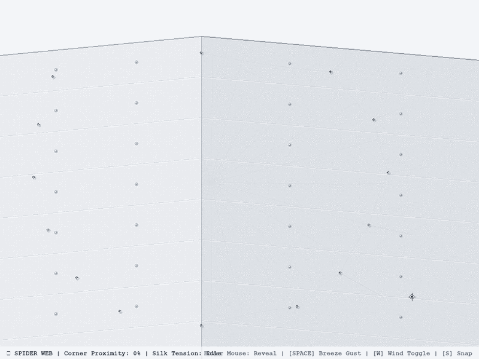

# 🕸️ Day 14: Interactive Spider Web on a Building Corner

> **30 Days of Python Challenge** · Level Up Your Python Skills  
> Created by **[@Tejas0113](https://github.com/Tejas0113)**

---

<p align="center">
  
</p>

<p align="center">
  
  
  
</p>

---

## 📖 Overview

Day 14 presents an architectural, interactive generative simulation: **Interactive Spider Web on a Building Corner**.

The artwork models an exterior vertical outside corner of a modernist concrete structure with a delicate, biological spider web suspended across the corner crevice between the two intersecting walls:
1. **Architectural Composition**:
   - Clean, minimal overcast sky (`#F5F6F9`) with two intersecting exterior concrete walls.
   - Left wall rendered under ambient light (`#ECEEF1`), right wall receding into directional shadow (`#DFE3E8`).
   - Procedural board-formed concrete casting seams, cylindrical tie-rod impressions, parapet roof coping, and subtle concrete grain texture.
2. **Biological Spider Web Geometry**:
   - Spanning across the corner attached to 14 concrete anchor points via microscopic **piriform silk attachment pads**.
   - Structural bridge lines forming an organic polygonal perimeter.
   - Central hub with tight reinforcing spirals and an authentic free zone.
   - 24 radial spokes extending outward to the frame lines.
   - 28 turns of capture spiral rendered using **inward catenary Bézier arcs** (not straight chords or geometric polygons), complete with microscopic viscid glue droplets.
3. **Interactive Mouse Dynamics (Proximity & Aerodynamics)**:
   - **Initial State**: The web is nearly invisible ($\sim 3\%$ opacity, barely catching a glint of light).
   - **Corner Approach**: As the mouse approaches the building corner, delicate outer frame lines and radial spokes gradually emerge into view.
   - **Full Revelation**: Moving the mouse directly over the web reveals all 820 silk strands in crisp, 100% detail.
   - **Smooth Fade-Out**: Moving away causes the web to smoothly fade back into near invisibility through continuous exponential smoothing.
   - **Aerodynamic Flutter**: Mouse motion imparts kinetic energy to the local air volume, causing flexible silk strands to vibrate and sway naturally with damped harmonic wave physics.

---

## 🧠 Concepts & Mathematical Mechanics

### 1. Inward Catenary Sagging Arcs (Viscid Silk Tension)
Real orb-weaver silk is elastic. Under surface tension and gravity, capture spiral segments between consecutive spokes sag inward toward the hub:

$$\mathbf{M} = \frac{\mathbf{P}_1 + \mathbf{P}_2}{2}$$

$$\hat{\mathbf{v}}_{\text{sag}} = \frac{0.85\, \hat{\mathbf{v}}_{\text{inward}} + 0.15\, \hat{\mathbf{v}}_{\text{gravity}}}{\|0.85\, \hat{\mathbf{v}}_{\text{inward}} + 0.15\, \hat{\mathbf{v}}_{\text{gravity}}\|}$$

$$\mathbf{C} = \mathbf{M} + (0.075 \cdot \|\mathbf{P}_2 - \mathbf{P}_1\|) \cdot \hat{\mathbf{v}}_{\text{sag}}$$

$$\mathbf{B}(t) = (1 - t)^2 \mathbf{P}_1 + 2(1 - t)t \mathbf{C} + t^2 \mathbf{P}_2, \quad t \in [0, 1]$$

Sampling $\mathbf{B}(t)$ produces authentic sagging catenary curves that eliminate rigid polygon artifacts.

### 2. Dual-Component Proximity Illumination Field
Each silk strand $k$ evaluates both global corner proximity and localized spotlight distance:

$$D_{\text{hub}} = \|\mathbf{m} - \mathbf{H}\|, \quad d_k = \|\mathbf{m} - \mathbf{C}_k\|$$

$$P_{\text{global}} = \begin{cases} 1.0, & D_{\text{hub}} \le 60 \\ 0.03 + 0.97 \left(\frac{1 + \cos\left(\pi \frac{D_{\text{hub}} - 60}{420}\right)}{2}\right)^{1.3}, & 60 < D_{\text{hub}} < 480 \\ 0.03, & D_{\text{hub}} \ge 480 \end{cases}$$

$$f_{\text{local}} = \begin{cases} \left(1 - \frac{d_k}{220}\right)^2, & d_k < 220 \\ 0.0, & d_k \ge 220 \end{cases}$$

$$\alpha_k^{\text{target}} = \text{clamp}\left(P_{\text{global}} \cdot 0.70 + f_{\text{local}} \cdot 0.50, 0.03, 1.0\right)$$

Continuous temporal interpolation guarantees zero abrupt popping:

$$\alpha_k(t + \Delta t) = \alpha_k(t) + (\alpha_k^{\text{target}} - \alpha_k(t)) \cdot \lambda \Delta t$$

### 3. Aerodynamic Air Disturbance & Damped Silk Vibration
Rapid cursor movement imparts an air impulse that decays exponentially:

$$I = \min(7.0, \|\mathbf{v}_{\text{mouse}}\| \cdot 0.12) \cdot \max\left(0.0, 1.0 - \frac{D_{\text{hub}}}{400}\right)$$

$$E_{\text{air}}(t + \Delta t) = E_{\text{air}}(t) \cdot e^{-\gamma \Delta t} + I$$

$$\delta(s, t) = \left(w_{\text{ambient}}(t) + E_{\text{air}} \sin(\omega t)\right) \cdot \sin(\pi s) \cdot \kappa_{\text{strand}}$$

Because $\sin(\pi s) = 0$ at $s = 0$ and $s = 1$, the thread endpoints remain firmly bonded to the concrete walls while the mid-span flutters naturally in the breeze.

---

## 🛠️ Installation & Dependencies

Ensure Python 3.10+ is installed. Install the required graphics libraries:

```bash
pip install pygame-ce numpy pillow
```

---

## 🚀 How to Run

You can run either the root executable or the module entry point:

```bash
# Option 1: Root executable
python day14_spider_web.py

# Option 2: Days folder entry point
python days/Day-14-Spider-Web/main.py
```

---

### 🎮 Keyboard & Mouse Controls

| Input | Action |
| :---: | :--- |
| **Mouse Hover** | Dynamic proximity reveal & aerodynamic air disturbance (no clicking required) |
| **`[SPACE]`** | Trigger a sudden air breeze gust impulse |
| **`[W]`** | Toggle ambient wind draft (On / Off) |
| **`[S]`** | Save a high-resolution screenshot (`spider_web_corner.png`) |
| **`[F]`** | Toggle fullscreen mode |
| **`[ESC]` / `[Q]`** | Exit application cleanly |

---

<p align="center">
  <a href="../../README.md"><b>⬅️ Return to 30 Days Challenge Tracker</b></a>
</p>
