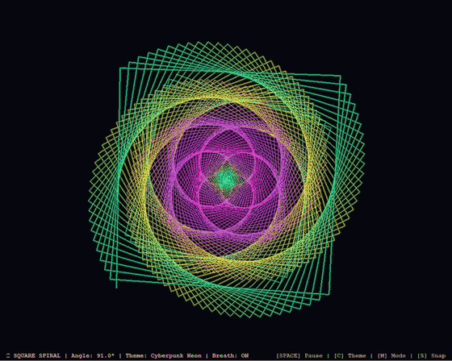

# 🌀 Day 15: Geometric Square Spiral Vortex Art

> **30 Days of Python Challenge** · Level Up Your Python Skills  
> Created by **[@Tejas0113](https://github.com/Tejas0113)**

---

<p align="center">
  
</p>

<p align="center">
  
  
  
</p>

---

## 📖 Overview

Day 15 elevates the classic **$91^\circ$ expanding square spiral** algorithm into a futuristic, hardware-accelerated kinetic generative masterpiece: **Geometric Square Spiral Vortex Art**.

The original seed algorithm:
```python
for x in range(500):
    forward(x + 50)
    right(91)
```
is elevated into a living, breathing cybernetic vortex with multi-pass neon bloom, harmonic angular breathing, dual counter-rotating geometry, and silky chromatic flow:
1. **Kinetic 4-Arm Vortex Tunnel**: By incrementing length on each step ($L_k = L_0 + k \cdot \Delta L$) while turning by an angle slightly exceeding a right angle ($\theta = 90^\circ + 1.0^\circ = 91.0^\circ$), the 4-corner geometry precesses by $1^\circ$ on every step ($4^\circ$ per full loop), weaving four curved hyperbolic spiral arms that radiate outward to infinity.
2. **Multi-Pass Neon Bloom & Laser Core**: Employs three distinct alpha-composited light passes:
   - Outer soft diffuse halo ($W = 6\text{--}8\text{ px}$, $\alpha \approx 45$) for ambient phosphor aura.
   - Mid vibrant neon corona ($W = 2.5\text{ px}$, $\alpha \approx 145$) for color saturation.
   - Core high-intensity laser spine ($W = 1\text{ px}$) with white luminance highlights.
3. **Harmonic Breathing Precession**: An automated harmonic oscillator modulates the turn angle ($\theta(t) = 91.0^\circ + 0.45^\circ \sin(\omega t)$), causing the entire 4-arm structure to gently twist, breathe, coil, and unfurl like a 4D tesseract.
4. **Dual Counter-Rotating Harmonics**: Incorporates an interlocking secondary spiral spinning in the opposite direction with an offset phase, producing deep hypnotic kinetic dimensionality.
5. **Centrifugal Stardust Aura**: High-energy particles drift outward from the central radiant star core along the spiral arms.

---

## 🧠 Concepts & Mathematical Mechanics

### 1. Polygonal Spiral Precession ($91^\circ$ Manifold)
The vertex trajectory $\mathbf{P}_k$ is generated recursively:

$$\mathbf{P}_{k+1} = \mathbf{P}_k + L_k \begin{bmatrix} \cos(\alpha_k) \\ \sin(\alpha_k) \end{bmatrix}, \quad \alpha_{k+1} = \alpha_k - \theta_{\text{turn}}$$

$$L_k = L_0 + k \cdot \Delta L$$

When $\theta_{\text{turn}} = \frac{2\pi}{N} + \Delta \theta$ with $N = 4$ (squares) and $\Delta \theta = 1.0^\circ$:
Every 4 segments:
$$\alpha_{k+4} = \alpha_k - 4 \cdot 91.0^\circ = \alpha_k - 364.0^\circ \equiv \alpha_k - 4.0^\circ$$
This $4.0^\circ$ angular offset per cycle prevents closed loops and creates continuous hyperbolic curvature across the 4 arms.

### 2. Real-Time Harmonic Angle Modulation
The turn angle oscillates continuously:

$$\theta_{\text{turn}}(t) = \theta_{\text{base}} + A_{\text{breath}} \sin(\omega_b t)$$

- **At $90.0^\circ$**: Classic concentric nested squares.
- **At $90.5^\circ$**: Ultra-dense deep hypnotic tunnel.
- **At $91.0^\circ$**: Perfectly balanced kinetic vortex arms.
- **At $92.5^\circ$**: Sweeping galactic cyclone.
- **At $93.0^\circ$**: 12-lobed crystalline mandala star.

### 3. Multi-Layer Phosphor Bloom Compositing
Each segment is blended using multi-width alpha compositing over a dedicated `SRCALPHA` surface:

$$\mathbf{C}_{\text{render}}(x, y) = \sum_{l=1}^{3} \mathbf{C}_{\text{theme}}(k) \odot \alpha_l(W_l)$$

This produces a tangible, glowing neon laser aesthetic without hardware performance degradation.

---

## 🎨 Chromatic Color Themes

Press **`[C]`** in real-time to cycle through 5 curated chromatic themes:

| Theme | Palette Description | Mood |
| :--- | :--- | :--- |
| **Cyberpunk Neon** | Electric Cyan (`#00F0FF`), Hot Magenta (`#FF1493`), Laser Violet (`#A020F0`), Solar Gold (`#FFD700`) | High-tech futuristic arcade |
| **Spectral Rainbow** | Continuous 360° HSV color wheel flowing along the spiral arms | Hypnotic psychedelic flow |
| **Solar Flare** | Crimson (`#DC143C`), Molten Orange (`#FF5A00`), Solar Gold (`#FFBE14`), Incandescent White | Blazing coronal energy |
| **Cosmic Aurora** | Celestial Turquoise (`#00E6B4`), Emerald Aurora (`#28FF78`), Mystic Violet (`#8228FF`) | Ethereal night-sky phenomenon |
| **Monochrome Silver** | Pure Diamond White (`#FFFFFF`), Platinum (`#C8D2E1`), Mercury Silver (`#96A0AF`) | Architectural minimalism |

---

## 🛠️ Installation & Dependencies

Ensure Python 3.10+ is installed:

```bash
pip install pygame-ce numpy pillow
```

---

## 🚀 How to Run

From the repository root:

```bash
python days/Day-15-Geometric-Square-Spiral/main.py
```

### 🎮 Interactive Controls

| Input | Action |
| :---: | :--- |
| **`[SPACE]`** | Pause / Resume rotation animation |
| **`[C]`** | Cycle Chromatic Color Themes (5 vibrant themes) |
| **`[B]`** | Toggle Harmonic Breathing Angle (On / Off) |
| **`[M]`** | Cycle Spiral Modes (Single Vortex, Dual Counter-Rotating, Breathing Tesseract) |
| **`[LEFT]` / `[RIGHT]`** | Interactively adjust turn angle ($88.0^\circ \leftrightarrow 95.0^\circ$ by $0.1^\circ$) |
| **`[UP]` / `[DOWN]`** | Increase / Decrease rotation speed |
| **`[R]`** | Reset angle to classic $91.0^\circ$ and default speed |
| **`[S]`** | Save high-resolution screenshot (`square_spiral_*.png`) |
| **`[F]`** | Toggle fullscreen mode |
| **`[ESC]` / `[Q]`** | Exit application cleanly |

---

<p align="center">
  <a href="../../README.md"><b>⬅️ Return to 30 Days Challenge Tracker</b></a>
</p>
