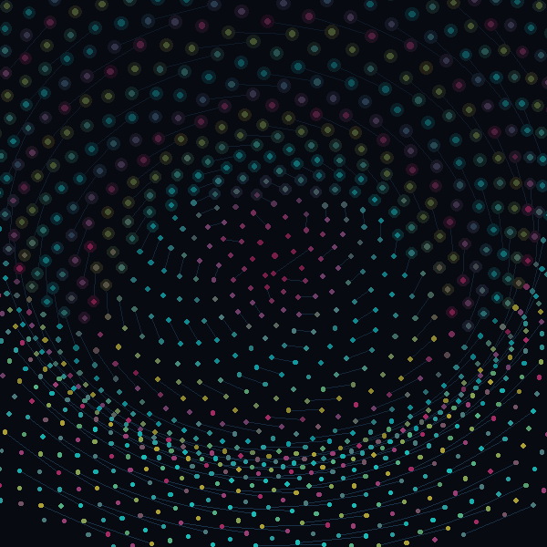

# 🌌 Day 19: 3D Kinetic Phyllotaxis Spiral Galaxy

> **30 Days of Python Challenge** · Level Up Your Python Skills  
> Created by **[@Tejas0113](https://github.com/Tejas0113)**

---

<p align="center">
  
</p>

<p align="center">
  
  
  
</p>

---

## 📖 Overview

Day 19 presents an extraordinary exploration of mathematical nature and cosmic geometry: **3D Kinetic Phyllotaxis Spiral Galaxy**.

Bridging botany, sacred geometry, and 3D celestial mechanics, this application simulates thousands of luminous particles organized according to the **Golden Ratio** ($\phi \approx 1.6180339887...$) and the **Golden Angle** ($\theta \approx 137.507764^\circ$), projecting them into an interactive 3D spatial coordinate field running at 60 FPS:

1. **4 Mathematical Spiral Topologies**:
   - **Mode 1: Fibonacci Sunflower Galaxy**: Expanding golden ratio spiral with 3D harmonic radial wave undulations ($z = A \sin(k r - \omega t)$).
   - **Mode 2: 3D Nautilus Shell Vortex**: Logarithmic spiral coiling through 3D space along the Z-axis ($r = a e^{b \theta}, z = c \theta$).
   - **Mode 3: Fermat's Dual-Chiral Vortex**: Interlocking counter-rotating spiral arms forming sacred geometric interference nodes.
   - **Mode 4: Toroidal Phyllotaxis Knot**: Phyllotaxis spiral mapped onto the curved 3-manifold surface of a 3D torus.
2. **Interactive 3D Camera & Physics**:
   - Click and drag mouse to orbit pitch and yaw with realistic rotational inertia and damping physics.
   - Scroll-wheel 3D perspective zoom ($0.3\times$ to $4.0\times$).
   - Depth-sorted rendering ($Z$-buffering) with atmospheric depth fogging, perspective radius scaling, and luminous particle halos.
3. **Constellation Filaments**:
   - Toggle geodesic connection lines (`[L]`) connecting Fibonacci harmonic neighbor nodes, revealing the hidden crystalline lattice of nature.
4. **6 Chromatic Themes**:
   - Cyberpunk Neon, Electric Cyan & Gold, Celestial Aurora, Solar Flare Amber, Deep Abyss Violet, and Pearl Monochrome.

---

## 🧠 Mathematical Architecture

```
┌─────────────────────────────────────────┐
│       Fibonacci Phyllotaxis Math        │
│    θ_n = n · 137.507764°, r_n = c√n     │
└────────────────────┬────────────────────┘
                     │
                     ▼
┌─────────────────────────────────────────┐
│     3D Surface / Wave Modulation        │
│   z_n = A · sin(k·r_n - ωt) · f(θ_n)    │
└────────────────────┬────────────────────┘
                     │
                     ▼
┌─────────────────────────────────────────┐
│     3D Pitch & Yaw Rotation Matrix      │
│   R_x(α) · R_y(β) · [x, y, z]^T         │
└────────────────────┬────────────────────┘
                     │
                     ▼
┌─────────────────────────────────────────┐
│  Perspective Divide & Depth Sorting     │
│   x' = cx + x·f / (z + d), y' = cy + ...│
└────────────────────┬────────────────────┘
                     │
                     ▼
┌─────────────────────────────────────────┐
│   Hardware Pygame Compositor (60 FPS)   │
│   • Luminous particle glow & halos      │
│   • Geodesic constellation filaments    │
│   • Telemetry HUD & screenshot export   │
└─────────────────────────────────────────┘
```

### Mathematical Foundations
- **The Golden Angle**:
  $$\theta_g = 2\pi \left(1 - \frac{1}{\phi}\right) \approx 137.507764^\circ \approx 2.3999632 \text{ rad}$$
- **Sunflower Seed Distribution (Vogel's Formula)**:
  $$r_n = c \sqrt{n}, \quad \theta_n = n \cdot \theta_g$$
- **Transverse Wave Undulation**:
  $$z_n(t) = A \cdot \sin(k r_n - \omega t) \cdot \left(1 + 0.3 \cos(2\theta_n)\right)$$
- **3D Perspective Projection**:
  $$x_{\text{screen}} = c_x + \frac{x \cdot f \cdot Z_{\text{zoom}}}{z + d}, \quad y_{\text{screen}} = c_y + \frac{y \cdot f \cdot Z_{\text{zoom}}}{z + d}$$

---

## 🎮 Interactive Keyboard & Mouse Controls

| Key / Input | Action | Description |
| :---: | :--- | :--- |
| **`[1]` – `[4]`** | **Topology Switch** | Switches between Sunflower, Nautilus, Dual-Chiral, and Toroidal Knot |
| **`[SPACE]`** | **Pause / Resume** | Freezes rotation and wave oscillation |
| **`[Left Drag]`** | **3D Camera Orbit** | Interactively rotates the 3D camera around pitch and yaw axes |
| **`[Mouse Wheel]`**| **3D Zoom** | Zooms smoothly in and out ($0.3\times$ to $4.0\times$) |
| **`[T]`** | **Cycle Themes** | Cycles through 6 curated color themes |
| **`[L]`** | **Filaments** | Toggles geodesic connecting lines between Fibonacci harmonic nodes |
| **`[W]` / `[S]`** | **Wave Amplitude** | Increases or decreases 3D transverse wave height |
| **`[+]` / `[-]`** | **Rotation Speed** | Speeds up or slows down orbital rotation and wave frequency |
| **`[R]`** | **Reset View** | Restores default camera orientation, zoom, and wave parameters |
| **`[H]`** | **Toggle HUD** | Shows or hides the telemetry HUD banner |
| **`[P]`** | **Screenshot** | Exports a high-resolution PNG screenshot to `output/` |
| **`[ESC]` / `[Q]`**| **Exit** | Safely exits application |

---

## 🛠️ Installation & Dependencies

Ensure Python 3.10+ is installed:

```bash
pip install pygame-ce opencv-python-headless numpy pillow
```

---

## 🚀 How to Run

Run directly from the repository root:

```bash
python "days/Day-19-Phyllotaxis-Spiral-Galaxy/main.py"
```

Or navigate into the project directory:

```bash
cd "days/Day-19-Phyllotaxis-Spiral-Galaxy"
python main.py
```

To run headless export mode (generating poster & animation preview):

```bash
python main.py --export
```

---

## 📁 Project Structure

```text
Day-19-Phyllotaxis-Spiral-Galaxy/
├── README.md   # Comprehensive project documentation
└── main.py     # Complete executable 3D kinetic spiral galaxy engine
```

---

<p align="center">
  <b>30 Days Python Challenge</b> · Made with ❤️ and Python by <a href="https://github.com/Tejas0113">@Tejas0113</a>
</p>
