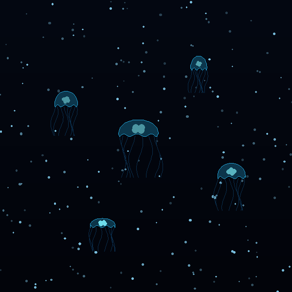

# 🪼 Day 20: Bioluminescent Deep-Sea Jellyfish Generative Art

> **30 Days of Python Challenge** · Level Up Your Python Skills  
> Created by **[@Tejas0113](https://github.com/Tejas0113)**

---

<p align="center">
  
</p>

<p align="center">
  
  
  
</p>

---

## 📖 Overview

Day 20 takes a radical, peaceful departure from geometric spirals into organic nature: **Bioluminescent Deep-Sea Jellyfish Generative Art**.

Simulating an abyssal oceanic ecosystem at 60 FPS in **Pygame-CE**, this project models procedural marine biology, spring-mass hydrodynamics, and ethereal bioluminescence:

1. **Procedural Jellyfish Anatomy & Hydrodynamics**:
   - **Pulsating Bell Dome**: Dynamically deformed Bezier dome that rhythmically contracts with asymmetric power strokes (rapid contraction providing upward thrust, followed by relaxed elastic recovery).
   - **Verlet-Integrated Trailing Tentacles**: Multi-segment spring chains with hydrodynamic fluid resistance and downward buoyancy drag that trail and sway organically.
   - **Frilled Oral Arms & Margin Scallops**: Delicate inner feeding arms with luminous bioluminescent highlights.
   - **Rhopalia & Luminous Gonadal Organs**: Internal cloverleaf organ cores that pulse with rhythmic biological illumination.
2. **Interactive Hydrodynamic Ecosystem**:
   - **Shockwaves & Fluid Currents**: Click anywhere to trigger expanding pressure ripples that physically deflect tentacles and marine snow.
   - **400+ Drifting Phytoplankton**: Marine snow particles drifting through ocean currents with stochastic bioluminescent blinking.
   - **6 Deep-Sea Chromatic Palettes**: Abyssal Azure, Emerald Phantasm, Crimson Siren, Neon Ultraviolet, Golden Sunburst, and Ghostly Moon Pearl.

---

## 🧠 Hydrodynamic & Architectural Pipeline

```
┌─────────────────────────────────────────┐
│        Asymmetric Pulse Generator       │
│    p(t) = sin(ωt)^1.8,  Thrust ∝ p(t)   │
└────────────────────┬────────────────────┘
                     │
                     ▼
┌─────────────────────────────────────────┐
│       Verlet Tentacle Integration       │
│   x_i(t+dt) = 2x_i - x_i(t-dt) + F_drag │
└────────────────────┬────────────────────┘
                     │
                     ▼
┌─────────────────────────────────────────┐
│       Harmonic Bell Deformation         │
│   W(t) = R·(1 - 0.22·p), H(t) = H·(1 + 0.35·p)
└────────────────────┬────────────────────┘
                     │
                     ▼
┌─────────────────────────────────────────┐
│     Phytoplankton & Shockwave Field     │
│   Drift currents + radial force impulse │
└────────────────────┬────────────────────┘
                     │
                     ▼
┌─────────────────────────────────────────┐
│   Hardware Pygame Compositor (60 FPS)   │
│   • Multi-layer alpha transparency      │
│   • Luminous organ glow & bloom halo    │
│   • Telemetry HUD & screenshot export   │
└─────────────────────────────────────────┘
```

---

## 🎮 Interactive Keyboard & Mouse Controls

| Key / Input | Action | Description |
| :---: | :--- | :--- |
| **`[Left Click]`** | **Shockwave Ripple** | Creates an expanding hydrodynamic water pulse that pushes tentacles and marine snow |
| **`[Right Click]`**| **Spawn Jellyfish** | Spawns a new procedural specimen at the cursor location |
| **`[SPACE]`** | **Pause / Resume** | Freezes the oceanic fluid simulation |
| **`[T]`** | **Cycle Themes** | Cycles through 6 deep-sea bioluminescent color palettes |
| **`[+]` / `[UP]`** | **Add Specimen** | Adds another floating jellyfish to the ecosystem |
| **`[-]` / `[DOWN]`**| **Remove Specimen**| Removes the last spawned jellyfish |
| **`[G]`** | **Toggle Bloom** | Toggles luminous bioluminescent halo glow |
| **`[C]`** | **Bloom Swarm** | Spawns a celebratory swarm of varied jellyfish specimens |
| **`[H]`** | **Toggle HUD** | Shows or hides the telemetry HUD banner |
| **`[P]`** | **Screenshot** | Exports a high-resolution PNG screenshot to `output/` |
| **`[ESC]` / `[Q]`**| **Exit** | Safely exits application |

---

## 🛠️ Installation & Dependencies

Ensure Python 3.10+ is installed:

```bash
pip install pygame-ce opencv-python-headless numpy pillow
```

---

## 🚀 How to Run

Run directly from the repository root:

```bash
python "days/Day-20-Bioluminescent-Jellyfish-Art/main.py"
```

Or navigate into the project directory:

```bash
cd "days/Day-20-Bioluminescent-Jellyfish-Art"
python main.py
```

To run headless export mode (generating poster & animation preview):

```bash
python main.py --export
```

---

## 📁 Project Structure

```text
Day-20-Bioluminescent-Jellyfish-Art/
├── README.md   # Comprehensive project documentation
└── main.py     # Complete executable bioluminescent deep-sea simulation
```

---

<p align="center">
  <b>30 Days Python Challenge</b> · Made with ❤️ and Python by <a href="https://github.com/Tejas0113">@Tejas0113</a>
</p>
