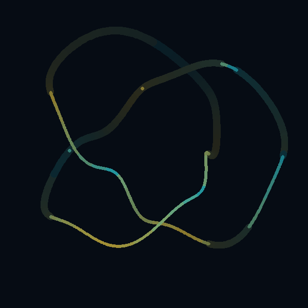

# 🧬 Day 21: 3D Quantum Torus Knot & Hopf Fibration Art

> **30 Days of Python Challenge** · Level Up Your Python Skills  
> Created by **[@Tejas0113](https://github.com/Tejas0113)**

---

<p align="center">
  
</p>

<p align="center">
  
  
  
</p>

---

## 📖 Overview

Day 21 elevates the 3D celestial mathematics introduced in Day 19 into the realm of higher-dimensional topology: **3D Quantum Torus Knot & Hopf Fibration Art**.

Rendering at a silky-smooth 60 FPS in **Pygame-CE**, this project models topological $(p, q)$ torus knots, standing wave energy packets, and the 4D Hopf fibration mapped into interactive 3D space:

1. **4 Topological Knot Manifolds**:
   - **Mode 1: Trefoil Quantum Knot ($p=2, q=3$)**: The simplest non-trivial prime knot, appearing in quantum field vortices and DNA supercoiling.
   - **Mode 2: Cinqfoil Sacred Knot ($p=5, q=2$)**: Five-pointed sacred star braid with harmonic orbital winding.
   - **Mode 3: Solar Septagram Knot ($p=7, q=3$)**: High-frequency interweaving harmonic braid with dense crossing nodes.
   - **Mode 4: Hopf Fibration Nested Torus ($p=1, q=1$)**: A continuous family of nested circle fibers partitioning the 3-sphere $S^3$, stereographically projected from 4D space into 3D.
2. **Interactive 3D Camera Controls**:
   - Click and drag mouse to orbit pitch and yaw with realistic rotational damping physics.
   - Scroll-wheel 3D perspective zoom ($0.3\times$ to $4.0\times$).
   - Perspective divide with depth sorting ($Z$-buffering) and radiant particle halos.
3. **Harmonic Standing Wave Oscillations**:
   - Modulate harmonic wave amplitude (`[W]` / `[S]`) and circulation velocity (`[+]` / `[-]`).
   - Toggle geodesic constellation filaments (`[L]`) connecting knot winding neighbors.
4. **6 Chromatic Themes**:
   - Cyberpunk Neon, Electric Cyan & Gold, Celestial Aurora, Solar Flare Amber, Deep Abyss Violet, and Pearl Monochrome.

---

## 🧠 Mathematical Architecture

```
┌─────────────────────────────────────────┐
│     (p, q) Torus Knot Parametrization   │
│  r(φ) = R + r_0·cos(qφ), x = r·cos(pφ)  │
│  y(φ) = r·sin(pφ), z = -r_0·sin(qφ)     │
└────────────────────┬────────────────────┘
                     │
                     ▼
┌─────────────────────────────────────────┐
│     Harmonic Wave Energy Packet         │
│   z'(φ, t) = z(φ) + A·sin(kφ - ωt)      │
└────────────────────┬────────────────────┘
                     │
                     ▼
┌─────────────────────────────────────────┐
│     3D Pitch & Yaw Rotation Matrix      │
│   R_x(α) · R_y(β) · [x, y, z']^T        │
└────────────────────┬────────────────────┘
                     │
                     ▼
┌─────────────────────────────────────────┐
│  Perspective Divide & Depth Sorting     │
│   x' = cx + x·f / (z + d), y' = cy + ...│
└────────────────────┬────────────────────┘
                     │
                     ▼
┌─────────────────────────────────────────┐
│   Hardware Pygame Compositor (60 FPS)   │
│   • Radiant particle halos & glows      │
│   • Geodesic energy filaments           │
│   • Telemetry HUD & screenshot export   │
└─────────────────────────────────────────┘
```

---

## 🎮 Interactive Keyboard & Mouse Controls

| Key / Input | Action | Description |
| :---: | :--- | :--- |
| **`[1]` – `[4]`** | **Knot Topology** | Switches between Trefoil, Cinqfoil, Septagram, and Hopf Fibration |
| **`[SPACE]`** | **Pause / Resume** | Freezes circulation and wave motion |
| **`[Left Drag]`** | **3D Camera Orbit** | Interactively rotates the 3D camera around pitch and yaw axes |
| **`[Mouse Wheel]`**| **3D Zoom** | Zooms smoothly in and out ($0.3\times$ to $4.0\times$) |
| **`[T]`** | **Cycle Themes** | Cycles through 6 curated color themes |
| **`[L]`** | **Filaments** | Toggles connecting energy filaments along the knot trajectory |
| **`[W]` / `[S]`** | **Wave Amplitude** | Increases or decreases standing wave height along the knot spine |
| **`[+]` / `[-]`** | **Circulation Speed**| Speeds up or slows down orbital node circulation |
| **`[R]`** | **Reset View** | Restores default camera orientation, zoom, and parameters |
| **`[H]`** | **Toggle HUD** | Shows or hides the telemetry HUD banner |
| **`[P]`** | **Screenshot** | Exports a high-resolution PNG screenshot to `output/` |
| **`[ESC]` / `[Q]`**| **Exit** | Safely exits application |

---

## 🛠️ Installation & Dependencies

Ensure Python 3.10+ is installed:

```bash
pip install pygame-ce opencv-python-headless numpy pillow
```

---

## 🚀 How to Run

Run directly from the repository root:

```bash
python "days/Day-21-Quantum-Torus-Knot/main.py"
```

Or navigate into the project directory:

```bash
cd "days/Day-21-Quantum-Torus-Knot"
python main.py
```

To run in headless export mode (generating poster & animation preview):

```bash
python main.py --export
```

---

## 📁 Project Structure

```text
Day-21-Quantum-Torus-Knot/
├── README.md   # Comprehensive project documentation
└── main.py     # Complete executable 3D quantum torus knot art engine
```

---

<p align="center">
  <b>30 Days Python Challenge</b> · Made with ❤️ and Python by <a href="https://github.com/Tejas0113">@Tejas0113</a>
</p>
