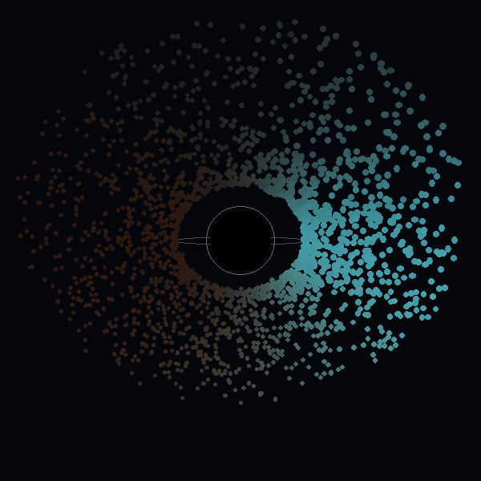

# 🕳️ Day 22: 3D Relativistic Black Hole & Accretion Vortex

> **30 Days of Python Challenge** · Level Up Your Python Skills  
> Created by **[@Tejas0113](https://github.com/Tejas0113)**

---

<p align="center">
  
</p>

<p align="center">
  
  
  
</p>

---

## 📖 Overview

Day 22 delivers an extraordinary astrophysical simulation: **3D Relativistic Black Hole & Accretion Vortex**.

Running at 60 FPS in **Pygame-CE**, this simulation visualizes general relativity, relativistic fluid mechanics, and gravitational optics:

1. **Schwarzschild Event Horizon & Photon Sphere**:
   - The central gravitational singularity is rendered with a pitch-black event horizon of radius $R_s = \frac{2GM}{c^2}$, encircled by the unstable photon capture sphere at $r = 1.5 R_s$.
2. **Relativistic Doppler Beaming ($I \propto \delta^4$)**:
   - 3,600+ Keplerian plasma particles orbit at relativistic velocities ($v(r) \propto 1/\sqrt{r}$).
   - Relativistic beaming dramatically intensifies and blue-shifts radiation from the oncoming orbital side, while red-shifting and dimming the receding side, recreating the authentic asymmetric crescent appearance observed in the Event Horizon Telescope (M87*) and *Interstellar*'s Gargantua.
3. **Gravitational Lensing Halo Ring**:
   - Light from the back of the accretion disk is gravitationally deflected above and below the event horizon, forming a glowing secondary photon ring.
4. **Bipolar Helical Magnetic Plasma Jets**:
   - High-energy relativistic particles shooting from both rotational poles, twisting along expanding helical magnetic field lines (`[J]` key).
5. **Interactive 3D Camera Controls**:
   - Drag to orbit pitch and yaw with inertia damping; mouse-wheel perspective zoom ($0.3\times$ to $4.0\times$).
   - 6 cosmic palettes: Interstellar Gold & Cyan, Singularity Violet, Solar Corona Amber, Quasar Azure, Abyssal Monochrome, and Emerald Nova.

---

## 🧠 Relativistic Physics Pipeline

```
┌─────────────────────────────────────────┐
│     Keplerian Relativistic Velocity     │
│       v(r) = √(GM / r),  ω = v / r      │
└────────────────────┬────────────────────┘
                     │
                     ▼
┌─────────────────────────────────────────┐
│     Relativistic Doppler Beaming        │
│       δ = 1 / [γ·(1 - β·cos θ_obs)]     │
│       Intensity Amplification ∝ δ^4    │
└────────────────────┬────────────────────┘
                     │
                     ▼
┌─────────────────────────────────────────┐
│     Gravitational Lensing Halo Ring     │
│    Photon Sphere Deflection r = 1.5 Rs  │
└────────────────────┬────────────────────┘
                     │
                     ▼
┌─────────────────────────────────────────┐
│     Bipolar Helical Magnetic Jets       │
│    Lorentz Lorentz Force r(u), φ(u, t)  │
└────────────────────┬────────────────────┘
                     │
                     ▼
┌─────────────────────────────────────────┐
│   Hardware Pygame Compositor (60 FPS)   │
│   • Pitch black event horizon disk      │
│   • Asymmetric Doppler color gradient   │
│   • Telemetry HUD & screenshot export   │
└─────────────────────────────────────────┘
```

---

## 🎮 Interactive Keyboard & Mouse Controls

| Key / Input | Action | Description |
| :---: | :--- | :--- |
| **`[SPACE]`** | **Pause / Resume** | Freezes relativistic orbital motion and jet flow |
| **`[Left Drag]`** | **3D Camera Orbit** | Interactively rotates the 3D camera around pitch and yaw axes |
| **`[Mouse Wheel]`**| **3D Zoom** | Zooms smoothly in and out ($0.3\times$ to $4.0\times$) |
| **`[T]`** | **Cycle Themes** | Cycles through 6 cosmic color palettes |
| **`[J]`** | **Toggle Jets** | Toggles bipolar relativistic magnetic plasma jets |
| **`[L]`** | **Toggle Lensing** | Toggles gravitationally lensed secondary photon ring |
| **`[W]` / `[S]`** | **Disk Density** | Expands or contracts the outer radius of the accretion disk |
| **`[+]` / `[-]`** | **Time Dilation** | Speeds up or slows down orbital simulation velocity |
| **`[R]`** | **Reset View** | Restores default camera view, zoom, and simulation parameters |
| **`[H]`** | **Toggle HUD** | Shows or hides the telemetry HUD banner |
| **`[P]`** | **Screenshot** | Exports a high-resolution PNG screenshot to `output/` |
| **`[ESC]` / `[Q]`**| **Exit** | Safely exits application |

---

## 🛠️ Installation & Dependencies

Ensure Python 3.10+ is installed:

```bash
pip install pygame-ce opencv-python-headless numpy pillow
```

---

## 🚀 How to Run

Run directly from the repository root:

```bash
python "days/Day-22-Black-Hole-Accretion-Disk/main.py"
```

Or navigate into the project directory:

```bash
cd "days/Day-22-Black-Hole-Accretion-Disk"
python main.py
```

To run in headless export mode (generating poster & animation preview):

```bash
python main.py --export
```

---

## 📁 Project Structure

```text
Day-22-Black-Hole-Accretion-Disk/
├── README.md   # Comprehensive project documentation
└── main.py     # Complete executable relativistic black hole simulation
```

---

<p align="center">
  <b>30 Days Python Challenge</b> · Made with ❤️ and Python by <a href="https://github.com/Tejas0113">@Tejas0113</a>
</p>
